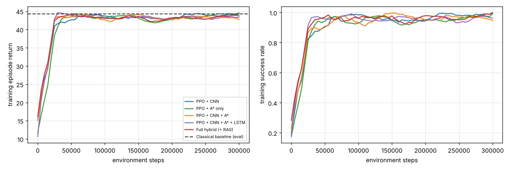
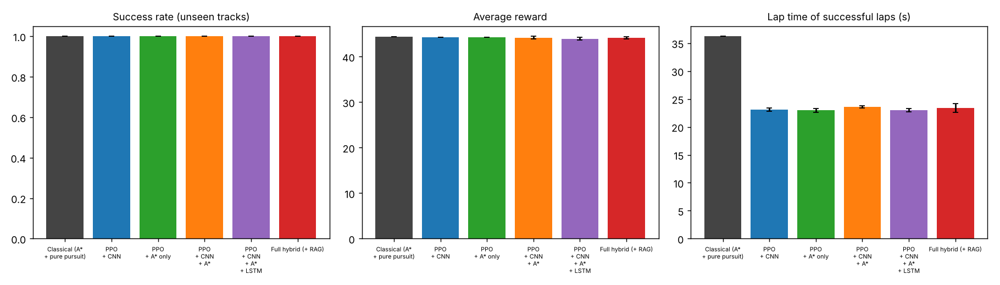
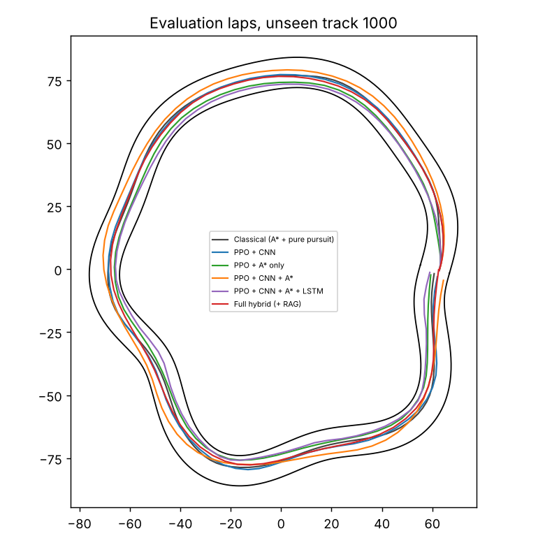

# Results — Autonomous Racing Agent

Evaluation: 20 episodes on 10 **unseen** tracks, deterministic policy, mean ± std over training seeds.

## Overall agent / ablation (DRL metrics)

| Agent | Success | Avg reward | Reward var | Ep. length | Lap time (s) | Skids/ep | Convergence (episodes) | Steps to 80% success |
|---|---|---|---|---|---|---|---|---|
| Classical (A* + pure pursuit) | 100% ± 0 | 44.4 ± 0.0 | 4.3 ± 0.0 | 362 ± 0 | 36.2 ± 0.0 | 0.0 ± 0.0 | - | - |
| PPO + CNN | 100% ± 0 | 44.3 ± 0.0 | 4.7 ± 0.1 | 231 ± 3 | 23.1 ± 0.3 | 8.7 ± 0.4 | 48 ± 5 | 20525 ± 2009 |
| PPO + A* only | 100% ± 0 | 44.2 ± 0.0 | 4.6 ± 0.1 | 230 ± 3 | 23.0 ± 0.3 | 8.9 ± 0.5 | 58 ± 12 | 19781 ± 5566 |
| PPO + CNN + A* | 100% ± 0 | 44.2 ± 0.3 | 4.8 ± 0.3 | 236 ± 2 | 23.6 ± 0.2 | 9.6 ± 5.8 | 46 ± 5 | 20547 ± 3372 |
| PPO + CNN + A* + LSTM | 100% ± 0 | 43.9 ± 0.3 | 4.9 ± 0.1 | 230 ± 3 | 23.0 ± 0.3 | 15.3 ± 5.4 | 42 ± 2 | 19459 ± 263 |
| Full hybrid (+ RAG) | 100% ± 0 | 44.2 ± 0.2 | 4.8 ± 0.2 | 234 ± 8 | 23.4 ± 0.8 | 9.7 ± 4.4 | 40 ± 1 | 17539 ± 1551 |

## Robustness stress test (success rate; hard = tighter, wigglier unseen tracks; camera noise = 10% pixels flipped)

| Agent | hard_tracks | camera_noise_10pct | hard_tracks+camera_noise |
|---|---|---|---|
| Classical (A* + pure pursuit) | 100% | 100% | 100% |
| PPO + CNN | 100% (min 100%) | 85% (min 55%) | 67% (min 0%) |
| PPO + A* only | 100% (min 100%) | 100% (min 100%) | 100% (min 100%) |
| PPO + CNN + A* | 70% (min 10%) | 100% (min 100%) | 70% (min 15%) |
| PPO + CNN + A* + LSTM | 100% (min 100%) | 100% (min 100%) | 97% (min 90%) |
| Full hybrid (+ RAG) | 100% (min 100%) | 100% (min 100%) | 100% (min 100%) |

## Search (A* vs BFS, full-lap planning, 10 unseen tracks)

| Method | Path length (units) | Nodes expanded | Search time (ms) |
|---|---|---|---|
| ASTAR | 429.7 | 1044 | 5.1 |
| BFS | 433.0 | 7753 | 12.1 |

## CNN road perception (3-class upcoming-corner classifier, unseen tracks, macro-averaged)

Accuracy 0.950 · Precision 0.808 · Recall 0.966 · F1 0.858 · lateral-offset MAE 0.24 units

## LSTM look-ahead road prediction (lateral offset of centreline at +10/+20/+35 units)

| Model | MAE | RMSE | Accuracy (|err|<1.5) |
|---|---|---|---|
| LSTM | 0.302 | 0.485 | 0.983 |
| Single-frame MLP (no memory) | 0.420 | 0.974 | 0.958 |

## RAG advisor (k=4, 21 driving situations)

Retrieval precision 0.67 · recall 0.62 · grounded-answer rate 1.00 · hallucination rate 0.00 · correct target-speed advice 1.00

